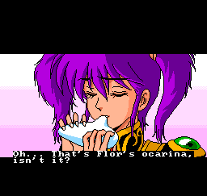
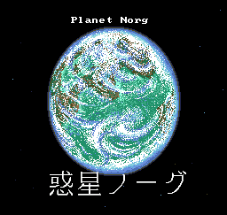
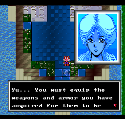

# Cosmic Fantasy — PC Engine CD English Patch

English dialogue, interface text and cinematic subtitles for **Cosmic Fantasy: Bouken Shounen Yuu** on PC Engine CD. The English text is based on the **Cosmic Fantasy Collection localisation for Switch**, adapted to the original PCE game. Japanese voice acting, music and original artwork are retained.

## Download

[Download the patch package](https://github.com/randomprojectsfactory/cosmic-fantasy-pce-english/releases/latest).

Release: **2026.10.30.1**. The package contains two xdelta patches, a hash-checking patcher and documentation. No game disc images, audio tracks, BIOS files or saves are included.

This release mainly corrects **SuperGrafx Mode I** cinematic compatibility while retaining standard PC Engine support and the previous CRT subtitle improvements. See [SuperGrafx compatibility and verification](SGX-COMPATIBILITY.md).

## Features

- English story dialogue, menus, shops, items and descriptions, status text and combat messages.
- English speech subtitles across the opening and voiced scenes, including in-game cinematic conversations, while preserving Japanese audio.
- A bilingual **Planet Norg** card that retains the original Japanese lettering and artwork. Original Japanese staff credits remain unchanged.
- English font and text wrapping/pagination adapted to the usable width of the native message boxes, with native choices and event progression retained.
- Corrected combat copy: attack messages identify the acting character and target in the proper order. Yu and Saya have the appropriate battle-command headings.
- Display corrections for menu cleanup, shops, battle sprites, cursor placement, and party visibility after an in-game Load.

## Required original disc

Use **Cosmic Fantasy - Bouken Shounen Yuu (Japan)** in the exact **99-track separate BIN/CUE layout** listed in [source-hashes.json](source-hashes.json). Tracks use raw 2352-byte sectors. The changed tracks must match:

| Original file | Bytes | SHA-256 |
| --- | ---: | --- |
| `Cosmic Fantasy - Bouken Shounen Yuu (Japan) (Track 02).bin` | 20,210,736 | `f893b19f66d24d30dbd51d086e65452681b0cedfe74ac822901146227948d97c` |
| `Cosmic Fantasy - Bouken Shounen Yuu (Japan) (Track 99).bin` | 19,864,992 | `a14230f17ee800d2e0cc912a398b489371b1d765192ea96f92804cb7f388ce64` |

The manifest lists the size and SHA-256 of all 99 original tracks and the original CUE, plus the expected patched hashes and patch hashes. Use an unmodified Japanese source. Merged images, converted ISOs, other revisions and previously patched tracks are not accepted.

## Requirements and patching

**System Card 3 / Super CD memory is required**, including when using an emulator or Turbo EverDrive Pro. Supply your own BIOS where required.

Install Python 3 and [xdelta3](https://github.com/jmacd/xdelta), with `xdelta3` on PATH. Extract the patch package, then check your original files:

```sh
python3 apply_patch.py "/path/to/original-disc-folder" --check
```

Create a translated copy in a new folder:

```sh
python3 apply_patch.py "/path/to/original-disc-folder" "/path/to/Cosmic Fantasy - Japan (T-En + Subs)"
```

On Windows, use `py -3` instead of `python3` if appropriate. The patcher checks every input, applies Tracks 02 and 99, copies the unchanged tracks and CUE, and verifies all outputs. It leaves the original folder intact. Launch the copied CUE with all 99 BIN files beside it.

For manual patching, apply each xdelta to its matching original track, keep the other tracks and CUE unchanged, and compare the results with the manifest.

## Cinematic subtitles

This release includes the CRT subtitle-renderer revision. See [renderer and CRT notes](SUBTITLE-RENDERER.md) for the visible changes and reported hardware results.





## English dialogue



Screenshots are emulator captures.

## Saves and hardware

The native save format is retained. Back up backup-memory saves before moving builds. Emulators and flash cartridges may associate saves and cheats with the CUE filename; retain that filename or copy its associated save data when renaming it. This patcher never modifies saves or cheat files.

The corrected renderer was tested in Beetle PCE / Mednafen with PCE + Super CD-ROM² and SGX + Super CD-ROM² configurations, with 38 cinematic/event checks passing in each. Hardware checks used a Turbo EverDrive Pro on **SuperGrafx in both Mode I and Mode II**, and on **PC Engine GT**. External-display checks included a **CRT** and a **RetroTINK-4K Pro with a flat panel**. The approved CRT subtitle presentation is retained. See [compatibility notes](SGX-COMPATIBILITY.md) for the scope of these checks. Display cropping depends on scaler settings; captions are designed for the game's display area.

## About the adaptation

These cinematics use the PCE game's graphics and CD playback routines rather than modern video files with external subtitle tracks. The captions therefore require an in-game renderer, playback-linked timing, careful graphics-memory ownership, and cleanup on scene transitions and skips. [Development notes](DEVELOPMENT.md) describe the work and [credits](CREDITS.md) acknowledge the original game and English localisation.

This is an unofficial adaptation with no affiliation or endorsement implied. Original game material and the existing English localisation remain the property of their respective rightsholders.
